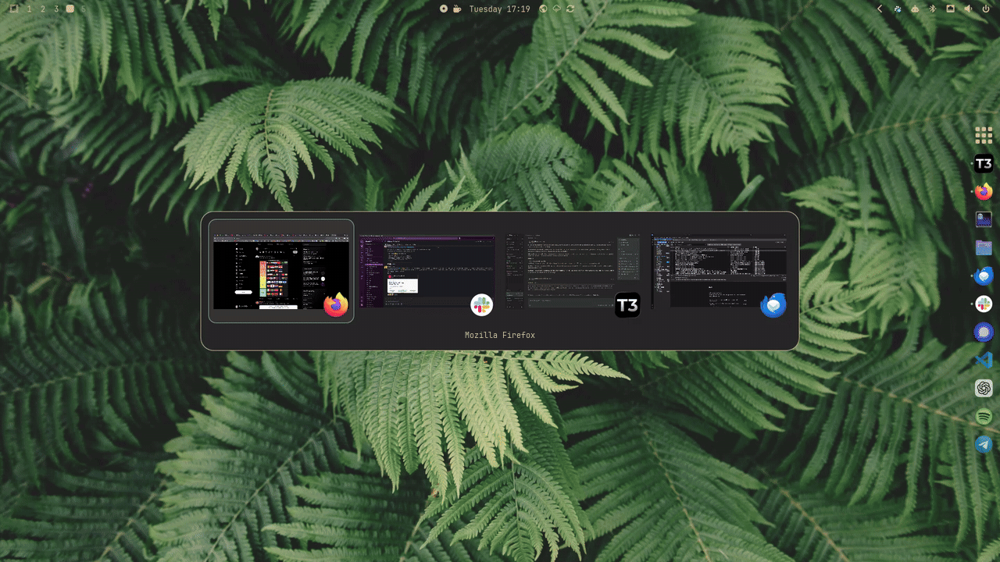

# Alt+Tab for Omarchy

A GNOME-style window switcher for [Omarchy](https://omarchy.org), as an
Omarchy shell plugin. Omarchy's default Alt+Tab focuses and raises the next
window on the current workspace with each press, with no preview and no "most
recent first". This one shows a panel instead:



- Hold Alt and press Tab: a panel shows a preview of every window, most
  recently used first, with the previous window selected. A quick Alt+Tab
  switches back and forth between two windows without the panel ever showing
  (it waits 150 ms, as GNOME does).
- Tab and Shift+Tab (or the arrow keys) move the selection while Alt is held;
  Shift+Alt+Tab opens it on the least recent window.
- Letting go of Alt focuses the selected window. Only the monitor that shows
  it changes workspace, and the pointer stays where it is.
- Escape, or a click beside the panel, closes it and keeps the window you were
  in. Clicking a preview picks it; pointing at one selects it once the pointer
  moves (one that happens to rest where the panel opens does not).

Every window is listed: on other workspaces and monitors, in the scratchpad
(picked, the scratchpad opens), and minimized (picked, it comes back to the
workspace in front). Dialogs are left out; they come up with their window.

Made for Omarchy 4 (its Quickshell shell and Hyprland's Lua config); tested
with Omarchy 4.0.0.alpha, Hyprland 0.57.1 and Quickshell 0.3.2. It needs
nothing beyond Omarchy itself; only the tests need a few tools (see Testing).

## Install

1. Add and enable the plugin:

   ```sh
   omarchy plugin add https://github.com/mitschabaude/omarchy-alt-tab.git --enable
   ```

2. Bind the keys. A plugin can't add Hyprland bindings itself, so load the
   plugin's `bindings.lua` from `~/.config/hypr/hyprland.lua`, after
   Omarchy's own bindings:

   ```lua
   dofile(os.getenv("HOME") .. "/.config/omarchy/plugins/mitschabaude.alt-tab/bindings.lua")
   ```

   It replaces Omarchy's Alt+Tab and Shift+Alt+Tab bindings, and binds
   letting go of left Alt. Hyprland reloads the config when you save it.

Update with `omarchy plugin update mitschabaude.alt-tab`. To remove it, delete
the `dofile` line first, then run `omarchy plugin remove mitschabaude.alt-tab`.

## Settings

The panel shows on the monitor you work on: the one with the focused window.
To always show it on one monitor instead, give the plugin's entry in
`~/.config/omarchy/shell.json` a `monitor`:

```json
"plugins": [
  { "id": "mitschabaude.alt-tab", "monitor": "DP-1" }
]
```

`hyprctl monitors` lists the names. While that monitor isn't connected, the
panel shows on yours. The switcher picks up changes to the file right away.

## Files

- `bindings.lua`: the key bindings. Alt+Tab and Shift+Alt+Tab send the
  `next` and `prev` shortcuts, and letting go of left Alt sends `commit`.
- `Switcher.qml`: the service. It registers the three Hyprland global
  shortcuts (`alt-tab:next|prev|commit`), keeps the recently-used order, and
  focuses the pick.
- `SwitcherWindow.qml`: the panel, on an overlay layer that takes the keyboard
  while open, so keys pressed with Alt held don't reach the window behind.
- `SwitcherModel.js`: ordering and selection, free of QML.

## How it works, and why

- **Order.** The switcher records each window as it gets the focus. Windows
  focused before the shell started fall back to Hyprland's own focus history.
- **Handing over the focus.** Hyprland won't focus a window while the panel's
  surface holds the keyboard. So the switcher takes the surface down, waits for
  Hyprland's `closelayer` event, then focuses the pick (with a 150 ms
  fallback). In that gap, Hyprland focuses whatever is under the pointer for a
  moment; the switcher doesn't count that as use, or a later Alt+Tab would go
  there instead of back where you were.
- **Your monitor** is the one with the focused window; with no window focused,
  the one Hyprland calls focused. The panel shows there unless a `monitor` is
  set, and a minimized window comes back to that monitor's workspace.
- **Releasing Alt** is seen twice: by a Hyprland release binding on left Alt
  (works however Alt was pressed) and by the panel itself, for either Alt.
  Either commits; the second does nothing. Right Alt has no binding, so it
  stays free for other uses.
- **Icons.** A window's icon comes from its desktop entry. Without one, its
  app id is used as an icon name, but only if it can be one (no slashes or
  colons): the id is whatever the app chose, and Qt would read a path as a
  file, which could block (a FIFO, say) and stall the shell.
- **Focusing** is one Lua dispatch: focus and raise, with cursor warps turned
  off for the switch and restored after.

## Testing

`tests/run.sh` runs every check in a hidden test desktop and prints ok/FAIL
for each, plus the path of a screenshot of the panel:

```sh
tests/run.sh
```

It doesn't touch the desktop in use: no window there moves, takes focus or
gets typed into, and the pointer stays put. The script checks that too.
It needs `foot`, `wtype`, `grim` and `jq`. `tests/hidden-desktop.sh` does the
setup:

- A second Hyprland, started with `dbus-run-session` (its own D-Bus) and a
  minimal config plus `bindings.lua`.
- Its window sits on a hidden special workspace, opened silently without focus.
  It draws only to two virtual (headless) monitors, `TEST-A` and `TEST-B`.
- The plugin runs there in a Quickshell of its own, with Omarchy's
  `qs.Commons` and a test `shell.json` that sets `TEST-A` as its monitor, not
  in a second Omarchy shell. That one would claim notifications, the tray and
  polkit on the real session.
- `hidden-desktop.sh run <cmd>` runs a command inside it (`foot`, `wtype`,
  `grim -o TEST-A`). `reload` restarts the switcher after an edit, `query
  selected|order|panel` asks the open switcher what it shows and where, and
  `stop` ends it all.

`tests/alt-tab.sh` plays one Alt+Tab there (taps, `--back`, `--escape`,
`--keys`, `--alt-key`, `--to TITLE`, `--shot FILE`).

One limit: Hyprland does not run its key bindings for simulated keys (wtype's
virtual keyboard reaches windows, but no binding fires). So the tests send
the shortcuts the bindings send (`hl.dsp.global("alt-tab:next")`). What only
real keys can show is that the bindings are in place; `hyprctl binds -j` lists
them, and one real Alt+Tab confirms it.

Work on a copy outside `~/.config/omarchy/plugins/`: the tests use the plugin
next to them, and every save under the plugins directory reloads the running
shell's plugins.

## License

[MIT](LICENSE)
